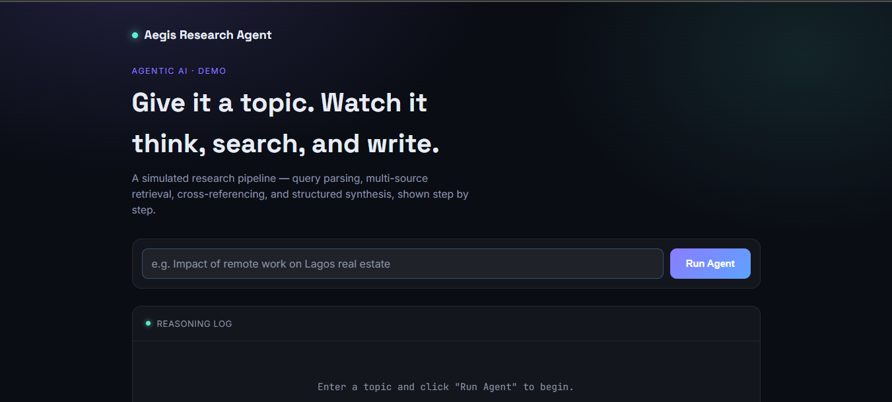
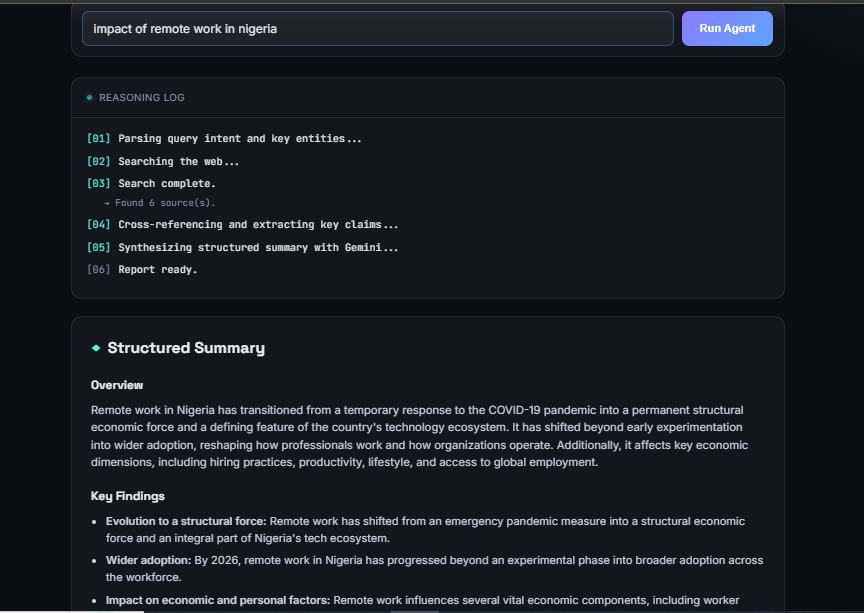
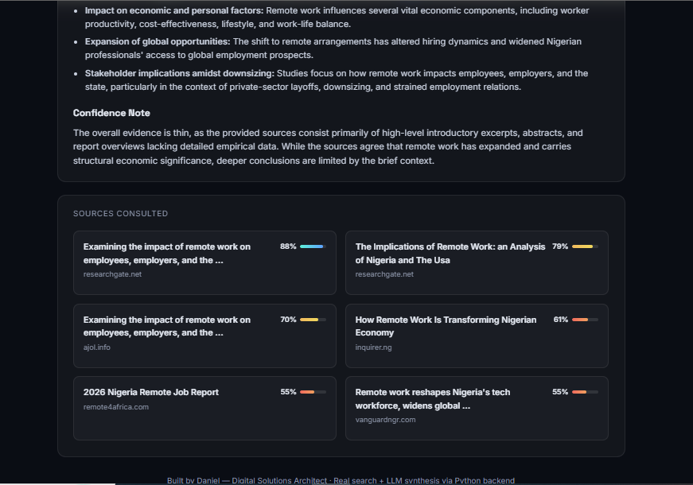

# Aegis Research Agent

An AI research agent that takes any topic, searches the live web, reads what it finds, and writes a structured, source-backed summary. A dashboard streams each step of its reasoning in real time.

Runs entirely on free tiers: DuckDuckGo search (no key) and Google Gemini's free API (no card).



## What it does

1. You type a topic, for example *"renewable energy adoption in Nigeria"*.
2. The agent searches the web and collects real sources.
3. It reads the results and writes a summary with an **Overview**, **Key Findings**, and a **Confidence Note**.
4. The dashboard shows each step as it happens, then the summary and clickable source cards.





## How it works

The agent is split into two separate steps. That split is what makes it an agent, rather than one black-box AI call:

| Step | Who does it | What happens |
|------|-------------|--------------|
| **Tool step** | Plain Python (`search_web` in `agent.py`) | Searches DuckDuckGo and returns titles, links, and snippets. No AI involved. |
| **Reasoning step** | Gemini | Reads only what the search returned and writes the summary. The prompt forbids facts that aren't in the results, and asks for a confidence note that flags disagreement or thin coverage. |

Progress is sent to the browser with Server-Sent Events, so the log reflects real work as it happens rather than a timed animation.

```
Browser (index.html)  --POST /api/research-->  Flask server (server.py)
        ^                                              |
        |                                      agent.py: search_web()  -> DuckDuckGo
        +------ streamed log + result  <--------        generate_content() -> Gemini
```

## Quick start (Windows)

1. Get a free Gemini API key at [aistudio.google.com/app/apikey](https://aistudio.google.com/app/apikey).
2. Install Python from [python.org](https://www.python.org/downloads/) and tick **Add Python to PATH**.
3. Install the dependencies:
   ```
   cd backend
   pip install -r requirements.txt
   ```
4. Double-click `start.bat`. It asks for your key, opens the page, and starts the server. Keep the black window open while you use the site.

Or run it by hand:

```
cd backend
set GEMINI_API_KEY=your-key-here
python server.py
```

Then open `index.html` in your browser. On Mac/Linux, use `export GEMINI_API_KEY=your-key-here` instead of `set`.

Your key is read from the environment only. It is never stored in the code or the repo.

## Project structure

```
aegis-research-agent/
  index.html          Dashboard (HTML/CSS/JS, no framework or build step)
  start.bat           One-click launcher for Windows
  backend/
    agent.py          The agent: search tool + Gemini reasoning
    server.py         Flask server that streams progress over SSE
    requirements.txt
```

## Stack

- **Backend:** Python, Flask, `ddgs` (DuckDuckGo search), `google-genai` (Gemini)
- **Frontend:** vanilla HTML, CSS, JavaScript, Server-Sent Events

## Limitations

- **Search is unofficial.** DuckDuckGo has no public API, so `ddgs` reads its search pages. It works well from a normal home connection. Cloud hosts sometimes get rate-limited or blocked, so for a deployed version a paid search API (Google Custom Search, Tavily, Bing) would be more reliable.
- **Gemini free tier has rate limits.** Fine for development and demos, not for heavy traffic. Google also retires model names over time. If you see a "model not found" error, update the `MODEL` constant at the top of `agent.py`.
- **Trust scores are placeholders.** `_trust_score` ranks sources by search order. It is not a real credibility model.
- **Summaries rest on search snippets,** not full page content, so depth is limited by what the snippets contain.
- **Not production-ready.** CORS is open and the endpoint has no authentication or rate limiting. Fine for local use; add protection before exposing it publicly.

## Ideas for next steps

- Fetch and read full pages instead of only snippets
- Replace placeholder trust scores with domain-reputation signals
- Let the agent run follow-up searches when it finds gaps (a true multi-step loop)
- Deploy the backend and add authentication and rate limiting

---

Built by Daniel as part of a portfolio of agentic AI projects.
